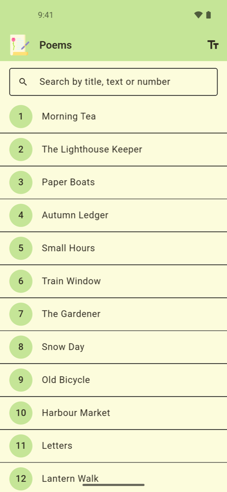
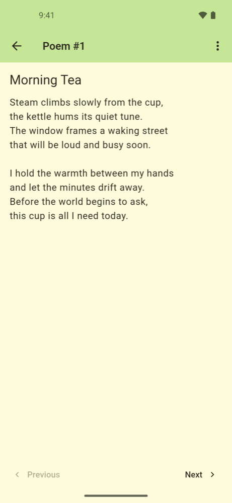
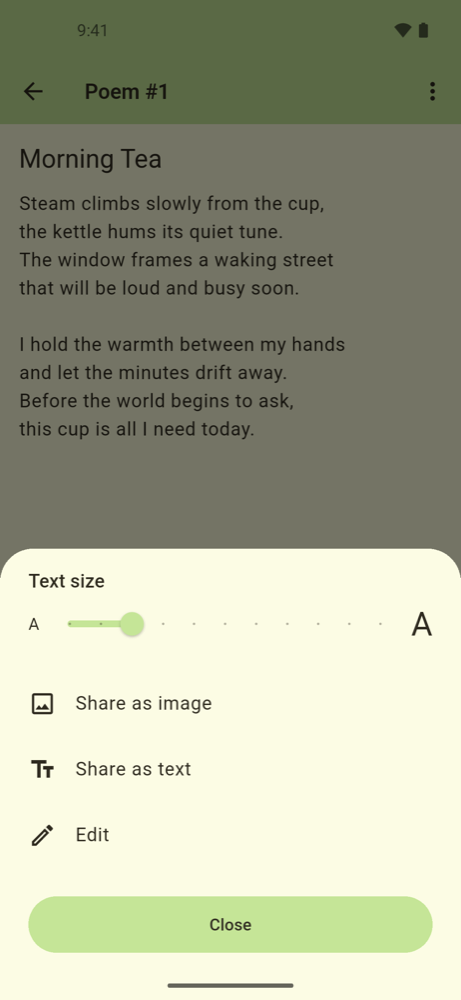
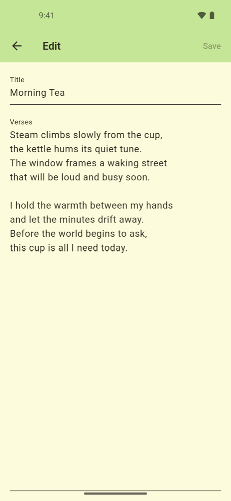
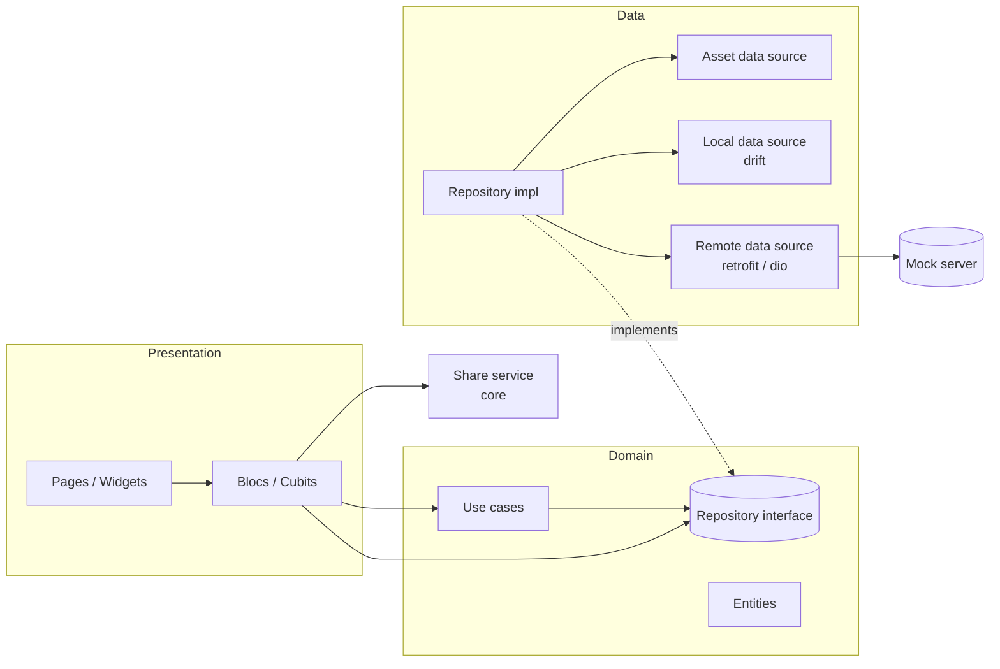

# Poem Studio

[](https://github.com/ulutashus/flutter-poem-studio/actions/workflows/ci.yml)

A small Flutter app for reading, searching, editing and sharing poems, built to show
**enterprise patterns at small scale**. Runs on Android, iOS and the web.

The domain is intentionally tiny so the architecture stays visible: layering,
dependency boundaries, offline-first sync and testing are applied the way they would be
in a larger codebase, in a form you can read in one sitting.

> The poems bundled in `assets/data/poems.json` are placeholder texts written for this demo.

| List | Search | Detail | Reading options | Edit |
| --- | --- | --- | --- | --- |
|  |  |  |  |  |

## What it demonstrates

| Concern | How |
| --- | --- |
| Architecture | Layered, with the dependency rule pointing inwards and repository interfaces in the domain; organised feature-first (`features/<feature>/{domain,data,presentation}`) |
| Single source of truth | The repository exposes reactive streams (drift `watch`); screens never refresh by hand |
| State management | `flutter_bloc` with `bloc_concurrency` (`restartable`, `droppable`) and a debounced search |
| Dependency injection | `get_it` + `injectable`; feature route modules resolve their blocs from the container; `app/` assembles the routes and provides the app-wide cubits |
| Error handling | Sealed `Result<T>` and sealed `Failure`s, mapped to localized messages with exhaustive `switch` |
| Offline-first sync | Local edits first; push/pull with last-write-wins inside database transactions |
| Networking | `dio` + `retrofit`; retry with exponential backoff as a Dio interceptor |
| Observability | `AppLogger` abstraction, global Flutter/platform error handlers, `BlocObserver` |
| Localization | `flutter_localizations` + `gen-l10n` with ARB files (English, Turkish) |
| Configuration | Injected `AppConfig` from `--dart-define-from-file`; no secrets in source |
| Testability | Time via `package:clock`, in-memory drift databases, fakes for HTTP adapters |
| Testing | Unit, bloc and widget tests plus a DI graph smoke test |
| Tooling | Strict analyzer, CI on GitHub Actions, a fake backend for local development |

## Architecture



Dependency rules:

- **Domain** is free of Flutter and I/O packages: no Flutter, no Dio, nothing from `data` (only the `injectable` annotation and `equatable` are used today); the architecture test also keeps `retrofit`, `shared_preferences`, `drift`, `dio`, `dart:io` and `dart:ui` out.
- **Presentation** depends on the domain through repository interfaces and use cases, never on `data`; blocs never depend on other blocs, following the [bloc library guidance](https://bloclibrary.dev/architecture/).
- **Data** implements domain interfaces and keeps DTOs and database rows to itself.
- **`core/`** is feature-agnostic code shared across the app (infrastructure such as errors, logging and networking, plus theme, localization and common widgets) and never imports a feature.
- **Features** may depend on another feature only through its barrel file (`<feature>.dart`), and the dependency graph stays acyclic. `poem` depends on `settings`; `settings` never imports `poem`.
- **`app/`** is the composition root: bootstrap, DI registration, the router that assembles feature route modules and the `MaterialApp`.

```
lib/
├── app/          # bootstrap, DI container, router, App widget, BlocObserver
├── core/         # bloc, config, error, l10n, logging, network, result, share, theme, widgets
└── features/
    ├── settings/          # locale and text scale: one SettingsRepository, text-scale use cases, cubits, settings sheet; exported via settings.dart
    └── poem/
        ├── domain/        # entities, repository contract, use cases (incl. search and validation rules)
        ├── data/          # asset/local/remote data sources, DTOs, mappers, repository
        └── presentation/  # blocs, pages, widgets, route paths and route module
```

### Design decisions

- **One `poem` feature, not one per screen.** A feature is a business capability. List, detail and
  edit share one entity, one repository and one set of rules; splitting them would force shared
  domain code into `core` or cross-feature imports.
- **Streams over manual refresh.** Editing a poem updates the list and the open detail page because
  both watch the same repository stream.
- **Use cases only where they earn their place.** Blocs and cubits take a repository interface
  directly. This matches the [Flutter architecture guide](https://docs.flutter.dev/app-architecture/guide),
  which treats the domain layer as optional, recommends adding use cases only when needed
  (merging several repositories, exceedingly complex logic, or logic reused by several view
  models) and lets a view model depend on both repositories and use cases. The use cases kept here
  hold business rules that should be testable without Flutter: search, edit validation and the
  text-scale range. None of them meets the guide's three conditions (each is used by a single
  bloc or cubit and is far from "exceedingly complex"); they are kept as a judgement call so the
  rules live in the domain. Pass-through wrappers around a single repository call are
  deliberately not written.
- **The feature owns its database.** `core` stays free of feature tables; another feature would
  add its own database or schema.

### Edit sync in a nutshell

1. Editing a poem writes it to the local database as *pending* and triggers a background sync.
2. Sync pushes pending edits (`PUT /api/v1/poems/edits/{id}`), then pulls all edits
   (`GET /api/v1/poems/edits`). Concurrent sync requests share one run.
3. Conflicts resolve by `updatedAt` (last write wins); a pending local edit is never overwritten.
4. Connection errors, timeouts and 5xx responses are retried with exponential backoff; other
   failures become typed `Failure`s, and the app bar offers a retry.

### Trade-offs and next steps

Deliberate simplifications, and what a production version would change:

- **Last write wins** relies on client clocks and drops the losing edit. Server-assigned versions
  with conflict detection (or a merge UI) would be the next step.
- **Full pull on every sync.** `GET /edits` returns everything; a `since` cursor or
  pagination would keep sync cheap as edits grow.
- **Shared API key, no user accounts.** Fine for a demo backend; real users need per-user
  auth (e.g. OAuth/JWT) and the key out of the client.
- **Edits only.** Poems ship as a bundled asset; creating and deleting poems would move the
  catalogue itself to the server.
- **One feature.** The structure is ready for more, but cross-feature concerns (shared
  navigation, feature flags) are untested until a second feature exists.

## Getting started

Requirements: Flutter **3.47.9**, pinned in `.fvmrc`. With [FVM](https://fvm.app), run `fvm install`
and prefix the commands below with `fvm`.

```bash
flutter pub get
flutter gen-l10n
dart run build_runner build --delete-conflicting-outputs
```

### Run the mock backend

`mock_server/` is a tiny [shelf](https://pub.dev/packages/shelf) server with an in-memory
store that implements the sync API.

```bash
cd mock_server
dart pub get
dart run bin/server.dart          # PORT=8080, POEMS_API_KEY=dev-key by default
```

### Run the app

```bash
cp dart_defines.example.json dart_defines.json
flutter run --dart-define-from-file=dart_defines.json
```

`http://10.0.2.2:8080` reaches your machine from the Android emulator; use
`http://localhost:8080` for the iOS simulator. The app works fully offline without the
server; only sync is unavailable.

### Run on the web

```bash
flutter run -d chrome --dart-define-from-file=dart_defines.json
```

Set `POEMS_BASE_URL` to `http://localhost:8080` (the mock server allows CORS). On the web,
drift runs SQLite as WebAssembly: `web/sqlite3.wasm` and `web/drift_worker.js` are prebuilt
from the drift package (not hand-written JavaScript) and must be regenerated when drift is
upgraded; see the [drift web docs](https://drift.simonbinder.eu/platforms/web/).

## Tests

```bash
flutter test                      # app: unit, bloc, widget and DI tests
(cd mock_server && dart test)     # mock server
```

## License

[MIT](LICENSE)
